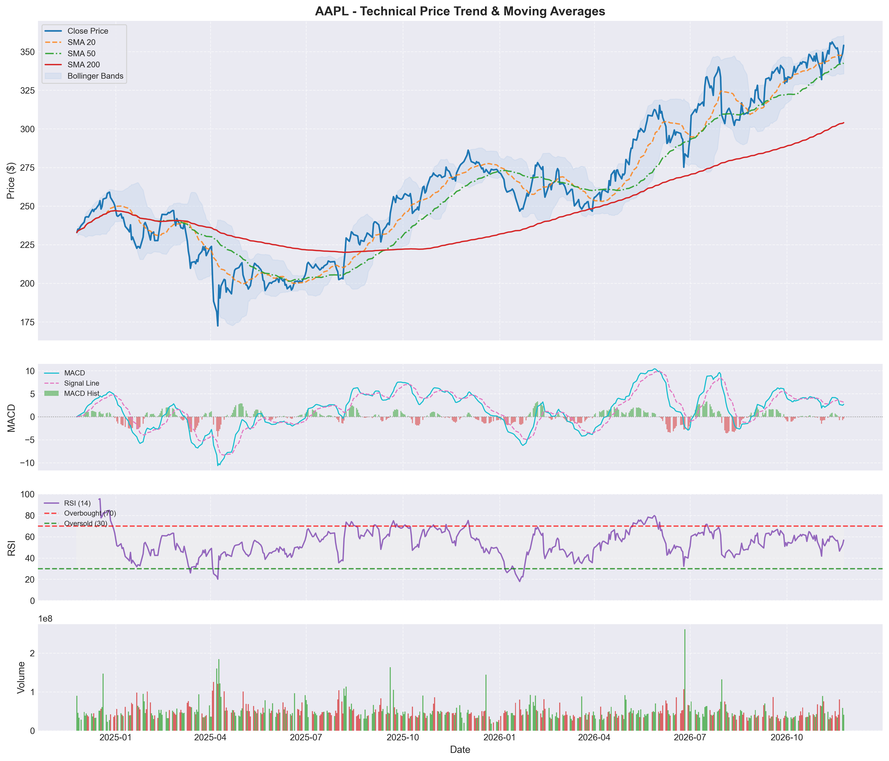
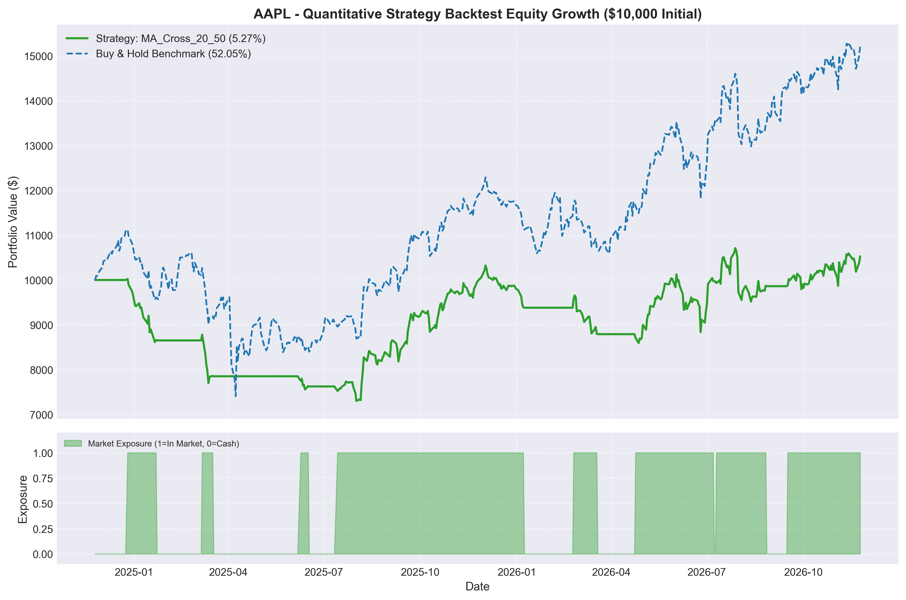
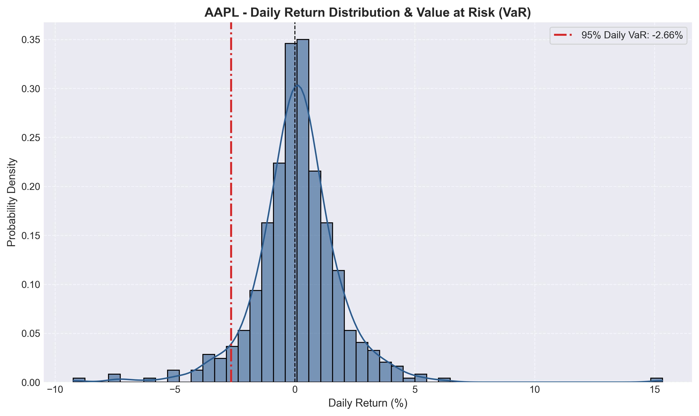
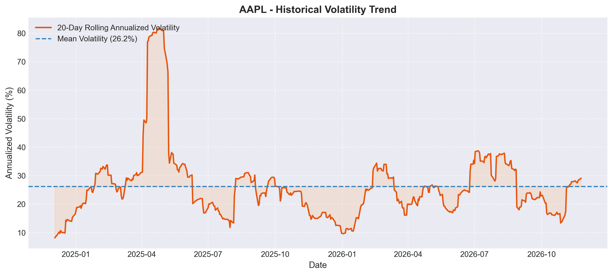

# 📈 Stock Market Data Analyzer & Quantitative Backtesting Terminal


> An end-to-end, industry-standard quantitative financial analytics system and REST microservice. Ingests historical and real-time market data, cleans time-series gaps, computes technical indicators, models risk metrics (Sharpe, Sortino, VaR, CVaR), executes algorithmic trading backtests, serves insights via FastAPI, and visualizes interactive watchlists and equity growth in a high-performance FinTech web dashboard.

---

## 📑 Table of Contents
1. [Project Overview](#-project-overview)
2. [Problem Statement & Industry Relevance](#-problem-statement--industry-relevance)
3. [Architecture & Workflow](#-architecture--workflow)
4. [Tech Stack Options & Selection](#-tech-stack-options--selection)
5. [Key Features](#-key-features)
6. [Folder Structure](#-folder-structure)
7. [Visual Gallery & Generated Outputs](#-visual-gallery--generated-outputs)
8. [Installation & Setup](#-installation--setup)
9. [How to Run the Project](#-how-to-run-the-project)
10. [REST API Documentation](#-rest-api-documentation)
11. [Quantitative Formulas Reference](#-quantitative-formulas-reference)
12. [Day-Wise Proof Building Plan](#-day-wise-proof-building-plan)
13. [Interview Preparation Guide](#-interview-preparation-guide)
14. [Social Media Launch Posts](#-social-media-launch-posts)
15. [Disclaimer](#-disclaimer)

---

## 📌 Project Overview

The **Stock Market Data Analyzer** is an institutional-grade financial analysis terminal designed for students, quantitative researchers, financial analysts, and software engineers. It eliminates reliance on expensive proprietary terminals (e.g., Bloomberg, Refinitiv) by leveraging free public market data feeds (`yfinance`), intelligent local caching, and offline synthetic data generators.

### Simple Explanation
Imagine an automated research assistant that tracks any stock ticker (e.g., Apple, Nvidia, Microsoft, Tesla), tracks its daily price swings, checks whether prices are trending upwards or downwards using moving averages, measures risk (volatility and paper losses), simulates what would have happened if you traded an automated strategy with $10,000, and presents everything on an interactive dark-mode dashboard.

### Technical Explanation
A modular Python framework that:
- Connects to Yahoo Finance via `yfinance`, sanitizing multi-index time-series data and forward-filling market holiday gaps.
- Calculates vectorized moving averages (SMA 20/50/200, EMA 12/26), momentum oscillators (RSI 14, MACD 12/26/9), and volatility bands (Bollinger Bands, ATR 14).
- Models risk distributions, computing Compound Annual Growth Rate (CAGR), Annualized Volatility ($\sigma \sqrt{252}$), Sharpe Ratio, Sortino Ratio, Maximum Drawdown, 95% Historical Value at Risk (VaR), and Conditional VaR (CVaR).
- Backtests algorithmic strategies (Dual Moving Average Crossover, RSI Mean-Reversion) with lag-adjusted execution (`shift(1)` to eliminate lookahead bias) and realistic transaction costs (0.1%).
- Exposes an asynchronous FastAPI REST microservice with OpenAPI / Swagger documentation and serves a responsive FinTech single-page web dashboard using Tailwind CSS and Chart.js.

---

## 🏢 Problem Statement & Industry Relevance

### The Problem
- **Information Overload:** Modern retail investors and aspiring analysts drown in raw price charts without rigorous statistical validation.
- **Cost Barriers:** Professional financial data terminals cost upwards of $24,000/year, restricting students and entry-level analysts from building proof of work.
- **Fragility in Data Pipelines:** Market data feeds frequently encounter rate limits, multi-index column breaking changes, and market holiday gaps that crash standard pipelines.
- **Lack of Objective Backtesting:** Decisions are often made on subjective chart patterns without simulating historical drawdowns, win rates, and transaction fee impacts.

### Industry Relevance
- **FinTechs & Brokerages:** Need robust REST APIs to power customer portfolio trackers, watchlist widgets, and real-time alert systems.
- **Hedge Funds & Quant Desks:** Rely on clean time-series feature engineering, vectorized strategy backtesting, and drawdown risk audits.
- **Data Analyst / Data Engineer Roles:** Demonstrates ETL pipeline construction, data cleaning, automated report generation, and API contract design.

---

## 📐 Architecture & Workflow

```
[ Market Feed (yfinance) ] ---> [ Data Ingestion & Sanitization ] ---> [ Local CSV Cache ]
                                              |
                                              v
                              [ Feature Engineering: Indicators ]
                                (SMA, EMA, RSI, MACD, BB, ATR)
                                              |
                       +----------------------+----------------------+
                       |                                             |
                       v                                             v
        [ Quantitative Risk Engine ]                 [ Strategy Backtester ]
       (Sharpe, Sortino, VaR, MDD)                  (MA Cross, RSI, Benchmark)
                       |                                             |
                       +----------------------+----------------------+
                                              |
                                              v
                                [ Delivery & Presentation ]
                   +--------------------------+--------------------------+
                   |                          |                          |
                   v                          v                          v
             [ CLI Terminal ]           [ FastAPI REST ]        [ Web Dashboard ]
          (`python main.py`)         (`http://...:8000/docs`)   (`.../dashboard`)
                   |                          |                          |
                   v                          v                          v
          [ Reports & Plots ]          [ JSON Schema ]          [ Chart.js / Live ]
```

### End-to-End Workflow
1. **Data Ingestion:** User specifies ticker and timeframe. Data is fetched via yfinance with fallback to cached CSV or synthetic Geometric Brownian Motion (GBM).
2. **Data Sanitization:** Multi-index column flattening, datetime index standardization, deduplication, and forward-fill imputation.
3. **Feature Engineering:** Vectorized calculation of daily returns, log returns, cumulative returns, moving averages, and oscillators.
4. **Risk Quantification:** Statistical computation of volatility, CAGR, Sharpe ratio, Sortino ratio, max drawdown, and tail-risk VaR/CVaR.
5. **Algorithmic Backtesting:** Simulation of entry/exit rules, trade logs, transaction costs, and comparative equity growth against the buy-and-hold benchmark.
6. **Delivery:** Concurrent rendering of Matplotlib/Seaborn static publication charts, structured JSON/Markdown executive audits, and interactive Chart.js web terminal.

---

## ⚙️ Tech Stack Options & Selection

| Dimension | Option A: Easy (Beginner) | Option B: Intermediate | Option C: Advanced (Selected) 🏆 |
| :--- | :--- | :--- | :--- |
| **Data Ingestion** | Static CSV file | Basic `yfinance` download | `yfinance` + Local CSV Cache + GBM Synthetic Fallback |
| **Analysis** | Excel / Pandas head/tail | Pandas + NumPy basic stats | Vectorized Technical Indicators + Quant Risk Engine |
| **Backtesting** | None | Simple profit calculation | Vectorized backtest with slippage, transaction costs & trade log |
| **Visualization** | Basic Matplotlib script | Seaborn static charts | Publication PNGs + Chart.js Interactive Dark Web UI |
| **Serving Layer** | Terminal print only | Basic Streamlit script | **FastAPI Asynchronous REST Microservice + Tailored Web UI** |
| **Target Roles** | Beginner Python Learner | Junior Data Analyst | **Quantitative Analyst, Python Developer, FinTech Backend Engineer** |

> **Selection Reason:** The **Advanced Option (Option C)** was selected because industry employers and recruiters evaluate candidates on scalable software architecture, modular Python design, API development (`FastAPI`), and clean UI presentation without depending on heavyweight prototyping wrappers like Streamlit.

---

## ✨ Key Features

- **Multi-Source Resilient Ingestion:** Online Yahoo Finance download, local caching (`data/`), and automatic synthetic market data generation if offline.
- **Complete Indicator Library:**
  - Trend: SMA (20, 50, 200), EMA (12, 26)
  - Momentum: RSI (14-period with Wilder smoothing), MACD (12, 26, 9) with histogram
  - Volatility: Bollinger Bands (20-period, $\pm 2\sigma$), Average True Range (ATR 14)
- **Quantitative Risk & Performance Suite:**
  - Annualized Volatility ($\sigma_{\text{daily}} \times \sqrt{252}$)
  - Sharpe Ratio ($R_f = 4.0\%$) & Downside Sortino Ratio
  - Maximum Drawdown (MDD) & Calmar Ratio
  - Historical 95% and 99% Daily Value at Risk (VaR) & Expected Shortfall (CVaR)
- **Systematic Strategy Backtesting:**
  - Dual Moving Average Crossover (Golden Cross / Death Cross)
  - RSI Mean-Reversion (30 Oversold / 70 Overbought)
  - Trade log with execution dates, entry/exit prices, return %, and win rate %
  - Outperformance Alpha generation against Buy & Hold benchmark
- **FastAPI REST API:** Full asynchronous microservice with Swagger documentation (`/docs`) and structured schemas.
- **FinTech Dark-Mode Web Dashboard:** High-contrast, responsive Tailwind CSS interface featuring interactive Chart.js price action, RSI oscillator, MACD histogram, and backtest equity curve.
- **Automated Research Reporting:** Exports publication-ready PNG charts, structured JSON metadata, and Markdown executive audits.

---

## 📁 Folder Structure

```text
Stock-Market-Data-Analyzer/
│
├── api/                                # FastAPI Microservice
│   └── main_api.py                     # REST endpoints, routers, CORS, and Pydantic models
│
├── data/                               # Data storage & cache
│   ├── AAPL_historical.csv             # Ingested & cached historical market data
│   └── AAPL_export.csv                 # Cleaned dataset with indicators for export
│
├── docs/                               # System Documentation
│   ├── ARCHITECTURE.md                 # System architecture, data flow & formulas
│   └── API_SPECIFICATION.md            # REST API endpoint contracts & payloads
│
├── images/                             # Visual proof & README assets
│   ├── AAPL_technical_dashboard.png    # Multi-panel technical chart
│   ├── AAPL_returns_distribution.png   # Returns histogram & VaR cutoff
│   ├── AAPL_volatility_trend.png       # 20-day rolling volatility
│   └── AAPL_backtest_equity_curve.png  # Strategy vs Benchmark equity growth
│
├── notebooks/                          # Jupyter Notebooks
│   └── Stock_Analysis_Walkthrough.ipynb # Step-by-step EDA & backtesting walkthrough
│
├── outputs/                            # Exported charts & visual artifacts
│   ├── AAPL_technical_dashboard.png
│   ├── AAPL_returns_distribution.png
│   ├── AAPL_volatility_trend.png
│   └── AAPL_backtest_equity_curve.png
│
├── reports/                            # Generated research audits
│   ├── AAPL_analysis_report.json       # Structured quantitative JSON payload
│   └── AAPL_executive_report.md        # Comprehensive Markdown audit report
│
├── src/                                # Core Modular Python Framework
│   ├── __init__.py                     # Package initialization
│   ├── data_fetcher.py                 # Resilient market data ingestion & cleaning
│   ├── indicators.py                   # Vectorized technical indicator computations
│   ├── risk_metrics.py                 # Statistical risk & performance engine
│   ├── backtester.py                   # Systematic strategy backtesting engine
│   ├── visualizer.py                   # Matplotlib/Seaborn static chart rendering
│   └── reporter.py                     # Automated JSON/Markdown report assembler
│
├── web/                                # Modern Web Dashboard (No Streamlit)
│   ├── static/                         # CSS / JS static assets
│   └── templates/
│       └── index.html                  # Responsive Tailwind + Chart.js FinTech UI
│
├── .gitignore                          # Git exclusions (cache, environments, logs)
├── main.py                             # Central CLI application & orchestrator
├── README.md                           # Master project documentation
└── requirements.txt                    # Python package dependencies
```

---

## 🖼️ Visual Gallery & Generated Outputs

### 1. Technical Price Trend & Moving Averages
Multi-panel visualization capturing Price Action with 20, 50, and 200 SMAs, Bollinger Bands, MACD, RSI (14), and Trading Volume.



### 2. Strategy Backtest Equity Growth Curve ($10,000 Portfolio)
Simulated performance of the Dual Moving Average Crossover Strategy vs. Buy & Hold Benchmark, including market exposure state.



### 3. Daily Returns Distribution & Value at Risk (VaR)
Histogram of daily percentage returns fitted with a Kernel Density Estimate (KDE) and the 95% Daily VaR risk cutoff.



### 4. 20-Day Rolling Annualized Volatility
Tracking time-varying volatility clustering against historical average regimes.



---

## 💻 Installation & Setup

### Prerequisites
- Python 3.10, 3.11, 3.12, or 3.13 installed
- Git installed
- Terminal / PowerShell

### 1. Clone or Navigate to the Project
```bash
cd "E:\IIT PROJECT\PYTHON 1\Stock-Market-Data-Analyzer"
```

### 2. Create and Activate a Virtual Environment
**On Windows (PowerShell):**
```powershell
python -m venv venv
.\venv\Scripts\Activate.ps1
```

**On macOS / Linux:**
```bash
python3 -m venv venv
source venv/bin/activate
```

### 3. Install Dependencies
```bash
pip install --upgrade pip
pip install -r requirements.txt
```

---

## 🚀 How to Run the Project

### Option A: Run End-to-End CLI Analysis
Run an immediate quantitative audit on Apple (`AAPL`) or any other stock:
```bash
# Analyze default ticker (AAPL) over 2 years
python main.py

# Analyze custom ticker (e.g. Nvidia, Tesla, Microsoft)
python main.py --ticker NVDA --period 2y

# Custom Moving Average parameters
python main.py --ticker TSLA --period 1y --fast 10 --slow 30

# Batch analyze top benchmark portfolio (AAPL, NVDA, MSFT, TSLA, SPY)
python main.py --all
```

**Sample CLI Output:**
```text
================================================================================
   ____ _____ ___   ____ _  __  __  __    _    ____  _  _______ _____ 
  / ___|_   _/ _ \ / ___| |/ / |  \/  |  / \  |  _ \| |/ / ____|_   _|
  \___ \ | || | | | |   | ' /  | |\/| | / _ \ | |_) | ' /|  _|   | |  
   ___) || || |_| | |___| . \  | |  | |/ ___ \|  _ <| . \| |___  | |  
  |____/ |_| \___/ \____|_|\_\ |_|  |_/_/   \_\_| \_\_|\_\_____| |_|  
                                                                       
        DATA ANALYZER & QUANTITATIVE STRATEGY BACKTESTING SYSTEM       
================================================================================

[+] Starting Financial Quantitative Analysis for: AAPL (Period: 2y)
---------------------------------------------------------------------------
  [Step 1/6] Ingesting market OHLCV data...
      -> Ingested 501 records from 2024-11-25 to 2026-11-24
  [Step 2/6] Computing Technical Indicators & Momentum Oscillators...
      -> Current Close: $354.07
      -> SMA 20: $348.08 | SMA 50: $342.58 | SMA 200: $303.99
      -> RSI (14): 56.71 | MACD: 2.697
      -> Technical Consensus Bias: Neutral
  [Step 3/6] Computing Statistical Risk & Performance Metrics...
      -> 52-Week Range: $172.42 - $356.27
      -> Annualized Return (CAGR): 23.51%
      -> Annualized Volatility: 29.06% (Rating: Moderate)
      -> Sharpe Ratio: 0.67 | Sortino Ratio: 0.92
      -> Max Drawdown: -33.43%
      -> 95% Daily VaR: -2.66% | Daily Win Rate: 53.2%
  [Step 4/6] Running Algorithmic Strategy Backtesting ($10,000 Portfolio)...
      -> Strategy: MA_Cross_20_50
      -> Final Strategy Capital: $10,527.28 (Return: 5.27%)
      -> Buy & Hold Benchmark Capital: $15,204.62 (Return: 52.05%)
      -> Alpha Generated: -46.77%
      -> Strategy Max Drawdown: -27.16%
      -> Executed Trades: 7 | Win Rate: 28.57%
  [Step 5/6] Generating Publication-Quality Financial Visualizations...
      -> Saved: AAPL_technical_dashboard.png
      -> Saved: AAPL_returns_distribution.png
      -> Saved: AAPL_volatility_trend.png
      -> Saved: AAPL_backtest_equity_curve.png
  [Step 6/6] Generating Structured Financial Research Reports...
      -> JSON Report: AAPL_analysis_report.json
      -> Executive Markdown: AAPL_executive_report.md
---------------------------------------------------------------------------
[✓] Analysis Completed Successfully for AAPL!
```

---

### Option B: Launch FastAPI Server & Modern Web Dashboard
Launch the interactive web terminal:
```bash
python main.py --serve
```
Then open your web browser:
- **Interactive FinTech Web Dashboard:** [http://127.0.0.1:8000/dashboard](http://127.0.0.1:8000/dashboard)
- **Interactive Swagger REST API Docs:** [http://127.0.0.1:8000/docs](http://127.0.0.1:8000/docs)
- **Alternative ReDoc API Spec:** [http://127.0.0.1:8000/redoc](http://127.0.0.1:8000/redoc)

---

## 📡 REST API Documentation

| Method | Endpoint | Description |
| :--- | :--- | :--- |
| `GET` | `/` | API status, health check, and routing metadata |
| `GET` | `/dashboard` | Renders modern responsive FinTech single-page web UI |
| `GET` | `/api/v1/stock/{ticker}` | Returns OHLCV records, computed indicators, and risk metrics |
| `GET` | `/api/v1/risk/{ticker}` | Statistical risk suite (Sharpe, Sortino, VaR, CVaR, Drawdown) |
| `POST`| `/api/v1/backtest` | Executes algorithmic strategy backtest and returns equity series |
| `GET` | `/api/v1/watchlist` | Curated live market snapshot with daily change % |
| `GET` | `/api/v1/export/{ticker}`| Downloads sanitized dataset with indicators as CSV |

---

## 📐 Quantitative Formulas Reference

1. **Daily Returns ($r_t$):**
   $$r_t = \frac{P_t - P_{t-1}}{P_{t-1}}$$

2. **Annualized Volatility ($\sigma_{\text{ann}}$):**
   $$\sigma_{\text{ann}} = \sigma_{\text{daily}} \times \sqrt{252}$$

3. **Compound Annual Growth Rate (CAGR):**
   $$\text{CAGR} = \left( \frac{P_{\text{end}}}{P_{\text{start}}} \right)^{\frac{252}{N}} - 1$$

4. **Sharpe Ratio:**
   $$\text{Sharpe} = \frac{\text{CAGR} - R_f}{\sigma_{\text{ann}}}$$

5. **Sortino Ratio:**
   $$\text{Sortino} = \frac{\text{CAGR} - R_f}{\sigma_{\text{downside}} \times \sqrt{252}}$$

6. **Maximum Drawdown (MDD):**
   $$\text{DD}_t = \frac{P_t - \max_{\tau \le t}(P_\tau)}{\max_{\tau \le t}(P_\tau)}, \quad \text{MDD} = \min_t(\text{DD}_t)$$

7. **Historical 95% Value at Risk (VaR):**
   $$\text{VaR}_{0.95} = \text{Percentile}(r_{\text{daily}}, 5\%)$$

---

## 🗓️ Day-Wise Proof Building Plan

| Day | Focus Area | Deliverables | Recommended Git Commit Message |
| :--- | :--- | :--- | :--- |
| **Day 1** | **Setup & Ingestion** | Project structure, virtualenv, `requirements.txt`, resilient `StockDataFetcher` with yfinance & cache. | `feat(ingestion): initialize project architecture and resilient yfinance data fetcher with cache fallback` |
| **Day 2** | **Feature Engineering** | Moving averages (SMA 20/50/200, EMA 12/26), RSI (14), MACD, Bollinger Bands, and trend consensus. | `feat(indicators): implement vectorized moving averages, RSI, MACD, and Bollinger Bands` |
| **Day 3** | **Risk Modeling Engine** | Sharpe ratio, Sortino ratio, max drawdown, historical 95% VaR, CVaR, and annual volatility. | `feat(risk): build institutional risk analytics engine for Sharpe, Sortino, and Value at Risk` |
| **Day 4** | **Strategy Backtesting** | Dual MA crossover, RSI mean reversion, equity curves, trade logs, slippage, and alpha calculation. | `feat(backtest): implement vectorized quantitative backtesting engine with equity curves and trade logs` |
| **Day 5** | **FastAPI & Web UI** | REST microservice endpoints (`/api/v1/stock`, `/api/v1/backtest`) and responsive Tailwind/Chart.js dashboard. | `feat(api): build asynchronous FastAPI microservice and modern dark-mode FinTech dashboard` |
| **Day 6** | **Reporting & Polish** | Matplotlib/Seaborn plot generator, JSON/Markdown executive report builder, and comprehensive README. | `docs(readme): finalize project documentation, executive reports, and visual proof gallery` |

---

## 🎯 Interview Preparation Guide

### 1. General Project Pitch: "Explain your project."
> **Answer:**  
> "I built the **Stock Market Data Analyzer**, an end-to-end quantitative financial analytics and strategy backtesting framework. It solves the challenge of turning noisy raw market data into institutional-grade investment insights without relying on paid terminals.
> 
> Architecturally, it has three layers:
> 1. **Data Ingestion & Cleaning:** A resilient pipeline using `yfinance` that handles multi-index columns, fills holiday gaps, and features an offline cache and synthetic market generator.
> 2. **Analytical & Risk Core:** Vectorized Pandas and NumPy algorithms calculating moving averages (SMA/EMA), momentum oscillators (RSI, MACD), and risk metrics including Annualized Volatility, Sharpe Ratio, Sortino Ratio, Maximum Drawdown, and 95% Value at Risk (VaR).
> 3. **Backtesting & Delivery:** A quantitative backtester that tests strategies against a buy-and-hold benchmark with realistic transaction fees, served through an asynchronous **FastAPI** REST microservice and an interactive dark-mode dashboard built with Tailwind CSS and Chart.js."

---

### 2. Technical Q&A

#### Q2: How did you prevent "Lookahead Bias" in your backtester?
- **Technical Answer:** "Lookahead bias occurs when a strategy uses price data from time $t$ to make a trading decision at time $t$. In `src/backtester.py`, I generated signals at close $t$, and then applied `data['Position'] = data['Signal'].shift(1)`. This ensures that the position is only executed on the subsequent trading bar ($t+1$), reflecting realistic market conditions."

#### Q3: What is the difference between Sharpe Ratio and Sortino Ratio?
- **Technical Answer:** "The Sharpe Ratio penalizes both upside and downside volatility equally. However, investors welcome upside volatility. The Sortino Ratio replaces total standard deviation in the denominator with downside semi-deviation ($\sigma_{\text{downside}}$), penalizing only negative returns. This provides a truer measure of risk-adjusted return for skewed distributions."

#### Q4: How does your data fetcher handle API rate limits and connection drops?
- **Technical Answer:** "I implemented a three-tier fallback architecture:
  1. Live ingestion via `yfinance` with automated multi-index column flattening.
  2. Local disk caching: successful ingests are serialized to `data/{ticker}_historical.csv`.
  3. Synthetic fallback: if the network is down and no local cache exists, it generates a realistic Geometric Brownian Motion (GBM) time-series matching the ticker's historical drift and volatility so the application never crashes during a demo."

#### Q5: Why did you choose FastAPI over Streamlit or Flask?
- **Technical Answer:** "While Streamlit is convenient for rapid prototyping, it re-runs the entire Python script on every user interaction, making it inefficient for heavy time-series workloads. FastAPI provides native asynchronous request handling, automatic OpenAPI/Swagger documentation, strict type validation via Pydantic, and allows decoupling the backend API from any frontend client, such as our Chart.js dashboard or a future Next.js app."

#### Q6: How is Value at Risk (VaR) calculated in your engine?
- **Technical Answer:** "I implemented historical Value at Risk at the 95% and 99% confidence levels:
  $$\text{VaR}_{0.95} = \text{Percentile}(r_{\text{daily}}, 5\%)$$
  It represents the daily loss threshold that will not be exceeded 95% of the time under normal market conditions. I also computed Conditional VaR (Expected Shortfall) to measure the average loss in the worst 5% tail."

#### Q7: How do you handle missing market data from holidays or weekends?
- **Technical Answer:** "Stock markets only trade on business days. First, I sanitize the index into a clean `DatetimeIndex` and drop duplicate timestamps. Then, I apply forward-fill (`.ffill()`) followed by backward-fill (`.bfill()`). This carries the last known closing price forward without introducing artificial prices."

#### Q8: What is a Golden Cross and Death Cross?
- **Technical Answer:** "A Golden Cross occurs when a short-term moving average (e.g., 50-day SMA) crosses above a long-term moving average (e.g., 200-day SMA), signaling an institutional bullish regime. A Death Cross occurs when the 50-day SMA crosses below the 200-day SMA, indicating a bearish downtrend."

#### Q9: How did you factor transaction costs into the backtest?
- **Technical Answer:** "Every time `Position` changes state (e.g., from cash 0 to long 1, or long 1 to cash 0), a trade event occurs. I tracked trades using `df['Trades'] = df['Position'].diff().abs()`, and subtracted a 0.1% (10 bps) fee per trade from the strategy's daily return: `Strategy_Return = Raw_Return - (Trades * 0.001)`."

#### Q10: How does this project demonstrate readiness for Data Analyst & FinTech roles?
- **HR & Recruiter Explanation:** "This project bridges data engineering, statistical modeling, and software delivery. It shows I can write clean, object-oriented Python, handle noisy time-series data, implement core mathematical finance formulas from scratch, design REST APIs, and build user-facing financial dashboards."

---

## 📱 Social Media Launch Posts

### 👔 LinkedIn Post
```text
🚀 Excited to share my latest project: Stock Market Data Analyzer & Quantitative Backtesting Terminal! 📈

As a student passionate about Financial Technology and Data Analytics, I wanted to build an industry-ready system that turns raw financial time-series data into actionable investment intelligence—without relying on expensive terminals.

🔍 What I built:
✅ Resilient Market Ingestion: Ingests historical & live data via yfinance with multi-tier fallback (local cache + Geometric Brownian Motion simulation).
✅ Technical Indicator Engine: Vectorized computations for SMA (20/50/200), EMA, RSI (14), MACD, and Bollinger Bands.
✅ Quantitative Risk Modeling: Computes Sharpe Ratio, Sortino Ratio, Maximum Drawdown, and 95% Value at Risk (VaR / CVaR).
✅ Algorithmic Strategy Backtesting: Systematic backtester simulating $10,000 portfolios with trade logs, slippage, and alpha benchmarking.
✅ FastAPI Microservice + Interactive Web Dashboard: Decoupled REST API with Swagger docs and a modern dark-mode FinTech UI built with Tailwind CSS & Chart.js (Zero Streamlit!).

🛠️ Tech Stack: Python 3.13, FastAPI, Pandas, NumPy, Matplotlib, Seaborn, Chart.js, Tailwind CSS.

💻 GitHub Repository: https://github.com/<your-username>/Stock-Market-Data-Analyzer

I would love to hear feedback from quantitative analysts, software engineers, and finance professionals! 

#Python #QuantitativeFinance #FinTech #DataAnalytics #FastAPI #DataScience #TradingStrategies #MachineLearning #GitHub #PortfolioProject
```

### 📸 Instagram Post / Carousel Caption
```text
Built my own Wall Street-grade Stock Market Data Analyzer from scratch using Python & FastAPI! 📊💻🔥

Swipe through to see:
👉 Slide 1: Multi-panel Technical Indicator Dashboard (Price, SMAs, MACD, RSI, Volume)
👉 Slide 2: Quantitative Backtest Equity Growth Curve ($10,000 portfolio vs Benchmark)
👉 Slide 3: 95% Daily Value at Risk (VaR) & Return Distribution Bell Curve
👉 Slide 4: Interactive FinTech Dark-Mode Web Dashboard powered by FastAPI & Chart.js
👉 Slide 5: Clean modular code architecture in VS Code

Key Metrics Modeled:
⚡ Sharpe Ratio & Sortino Ratio
⚡ Value at Risk (VaR) & Expected Shortfall (CVaR)
⚡ Dual Moving Average Crossover Backtesting
⚡ Maximum Drawdown analysis

No expensive terminals needed—just clean code, mathematical finance, and open data. 🚀

🔗 Full source code & installation guide on my GitHub (Link in bio)!

#python #coding #datascience #finance #fintech #quantitativefinance #programmer #stockmarket #developer #softwareengineer #buildinpublic
```

---

## ⚠️ Disclaimer

> **Educational & Academic Use Only:** This project is designed, developed, and maintained exclusively for academic, educational demonstration, and proof-of-work portfolio purposes. Nothing contained in this repository, documentation, API, or generated reports constitutes financial, investment, legal, or tax advice. Stock trading and investing carry significant financial risk.
